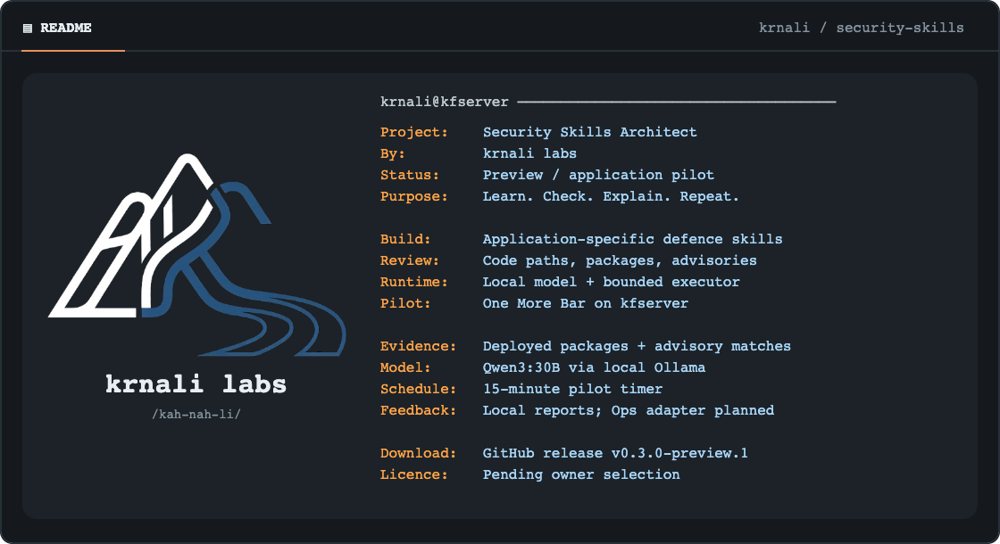
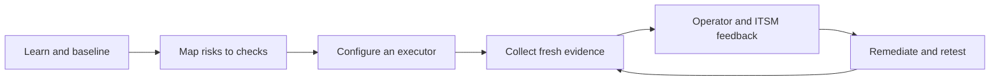

# Security Skills Architect



Build reusable agent skills that learn an application and keep watch for emerging vulnerabilities in its code and dependencies.

Security Skills Architect brings together a general skill engineering workflow and an application-specific defence builder. Start with a repository and deployed-dependency review, generate a dedicated skill for that application, then connect fresh advisory sources, code-path triage and operator feedback. The priority is newly disclosed risk, including exposure to vulnerabilities exploited as zero-days; advisory matching cannot guarantee detection of undisclosed flaws.

**Preview:** the packages and tooling are available for evaluation. Background monitoring, native host acceptance and live ITSM integrations have not been verified. Installing these skills does not start a monitoring service.

[Download the preview](https://github.com/krnali-io/security-skills-architect/releases/tag/v0.3.0-preview.2) · [Application workflow](skills/application-defence/SKILL.md) · [Engineering workflow](skills/skill-architect/SKILL.md)

## Choose a skill

| Skill | Use it for | Output |
|---|---|---|
| `skill-architect` | Design, build, review and evaluate reusable skills with evidence and continuing assurance | A versioned skill, specification, evaluation cases and release decision |
| `application-defence` | Learn a particular application and establish its defence workflow | A dedicated `defend-<application-id>` skill, evidence profile, checks, findings and ITSM handoff |

The project name is Security Skills Architect. The two invocation names above remain the package identifiers.

## Install in Codex

Ask the built-in installer to install either or both folders:

```text
Use $skill-installer to install these skills:
https://github.com/krnali-io/security-skills-architect/tree/v0.3.0-preview.2/skills/skill-architect
https://github.com/krnali-io/security-skills-architect/tree/v0.3.0-preview.2/skills/application-defence
```

Alternatively, download the individual ZIPs and `SHA256SUMS` from the release. Verify the downloaded files with `sha256sum -c SHA256SUMS` on Linux or `shasum -a 256 -c SHA256SUMS` on macOS; download every listed file to verify the complete set. Extract the desired skill folder into your project's `.agents/skills/` or your personal `~/.agents/skills/` directory. Preserve each folder name. For an upgrade, move the previous folder outside the skill discovery directory first so versions are not mixed.

Codex supports explicit `$skill-name` invocation and discovery from these locations. If the installed skill does not appear, restart Codex. See the [official skills guide](https://learn.chatgpt.com/docs/build-skills). Installation instructions follow the host documentation; this preview does not claim completed native-host acceptance.

Other Agent Skills hosts can use their documented installation mechanism. Test activation and resource access in your chosen host before relying on the workflow. These downloads are standalone skills; no marketplace plugin listing is claimed.

## First application review

Open your application repository in your agent and use:

```text
Use $application-defence to learn this application and generate its dedicated
security skill in ../private-defence-output.
Prioritize emerging vulnerabilities: inventory exact deployed dependencies,
query fresh advisories and known-exploitation sources, and review affected
code/configuration paths. Record vendor fixed releases or mitigations, source
freshness and unknown reachability. Map risks to repeatable checks.
Record missing runtime, host and network evidence explicitly.
Prepare a monitoring plan and a local ITSM export. Report what was actually
checked, what remains unknown, and the next operator actions.
```

Supply the application name, repository and environments if they are not already clear. The first useful review needs authorized repository access and a private output location. Host access and ITSM credentials can be added when those integrations are being configured.

Expected output includes:

```text
defend-your-application/
  SKILL.md
  SPEC.md
  README.md
  references/
  profile.json
  checks.json
  findings.json
  monitoring.json
  itsm.json
  runbook.md
  evals/
```

The profile captures architecture, relevant code, libraries and runtime, configuration, delivery paths, owners and evidence. Host/container/network coverage depends on available observations. Declared configuration is kept separate from deployed reality. Private application profiles and raw run evidence belong in your private workspace.

## Make defence ongoing

The generated skill guides a recurring loop:



Choose an existing CI runner, timer or monitoring service to execute the checks and retain their state. Define change triggers, cadence, evidence freshness, owners and escalation. Observe an actual scheduled run and exercise an independent missed-run alert before calling the monitoring active.

The workflow keeps stale evidence and failed checks visible. Missing telemetry cannot erase an open finding. Risk exceptions require an owner and expiry. A finding is resolved only when a fresh retest verifies the fix on the affected environment; closing a ticket alone is insufficient.

For ITSM setup, provide the platform, authorized connection, application/service mapping, routing group and priority policy. The builder prepares field mappings, stable correlation IDs and retry/reconciliation rules. For our own pilot, the intended operator destination is **Krnali Ops**. Its adapter is not connected yet. Other users can map the handoff to their own service-management systems. No live connector is bundled; exports remain unsent until an authorized integration is configured and verified.

## Local-model pilot

We built a private `defend-one-more-bar` skill and exercised it on kfserver. A fixed collector now inventories deployed Python distributions, queries OSV for exact-version matches, enriches CVE aliases using CISA KEV, and supplies findings to Qwen3:30B through local Ollama. Six container posture checks remain supplemental. A systemd timer schedules the pilot every 15 minutes; the model has no command tools. Reports currently stay in local files and the systemd journal. Krnali Ops delivery and full operational acceptance remain pending.

The pilot runner and private application profile are not included in the downloadable skill packages. The private pilot has exercised real advisory matches and targeted code review. Per-advisory reachability, other application components, native/OS/runtime advisories and broader infrastructure coverage remain incomplete. Package names and versions are sent to OSV; application code and local-model prompts remain local.

## Build another skill

```text
Use $skill-architect to build a skill for our recurring security review task.
Define its inputs, outputs, evidence requirements and failure behavior.
Include what can become stale, who owns failures and how corrections are verified.
Prepare realistic evaluation cases and report the evidence for release readiness.
```

The architect applies seven gates: contract, structure, safety, execution, discovery, result quality and user experience. Static validation is reported separately from agent behavior and operational integration tests.

## Run the local tooling

Python 3.10+ is required for the engineering tools. The defence builder itself contains instructions and references.

```sh
git clone https://github.com/krnali-io/security-skills-architect.git
cd security-skills-architect
python3 -m venv .venv
.venv/bin/python -m pip install -r skills/skill-architect/requirements-dev.txt
.venv/bin/python -m unittest discover -s skills/skill-architect/tests -v
.venv/bin/python skills/skill-architect/scripts/validate.py skills/skill-architect --profile engineered --json
.venv/bin/python skills/skill-architect/scripts/validate.py skills/application-defence --profile engineered --json
```

Build fresh local archives:

```sh
.venv/bin/python skills/skill-architect/scripts/build_preview.py \
  --skill skills/skill-architect \
  --skill skills/application-defence \
  --output dist/my-preview
```

The destination must be new. The builder creates ZIPs, a per-file manifest and checksums. It excludes private run history and checks the selected package before archiving. Checksums identify bytes; they are not signatures.

Plan a behavioral evaluation:

```sh
.venv/bin/python skills/skill-architect/scripts/evaluate.py \
  skills/application-defence --host codex --suite all --max-runs 40 \
  --output private-evidence/application-defence
```

This prints a plan without making model calls. Add `--run` to execute the reviewed plan with your existing host login; calls consume provider usage and send supplied evaluation context to that provider. Use synthetic or authorized inputs. The controlled-text evaluator cannot certify live monitoring or ITSM behavior.

## Evidence and preview limits

The initial preview passed 34 local tooling tests. Both packages and the unpacked release archives passed selected structural checks. The application builder has 16 planned scenarios and 8 trigger cases; they have not been executed as live acceptance tests. Earlier architect smoke results do not certify the new defence guidance.

Read the detailed [architect evidence](skills/skill-architect/VALIDATION.md) and [application builder evidence](skills/application-defence/VALIDATION.md). The package metadata records its local preparation status; GitHub release publication does not change its conditional engineering verdict.

Further acceptance work includes broader application components, per-advisory code-path evidence, repeated local-model quality evaluations, native activation, scheduler recovery and a verified krnali Ops handoff. CI runs local tooling checks only and contains no application deployment job. Future Krnali-hosted services default to kfserver; other providers need explicit authorization.

## Feedback and licence

Use [GitHub issues](https://github.com/krnali-io/security-skills-architect/issues) for sanitized bug reports and feature requests. Include the skill version, host version, expected result, actual result and a minimal reproduction. Keep credentials, private repositories and raw customer traces out of public issues.

A public reuse licence has not yet been selected. This repository is published as a preview for inspection and feedback; no open-source licence grant is asserted. The licence decision will be recorded explicitly when selected by the owner.
